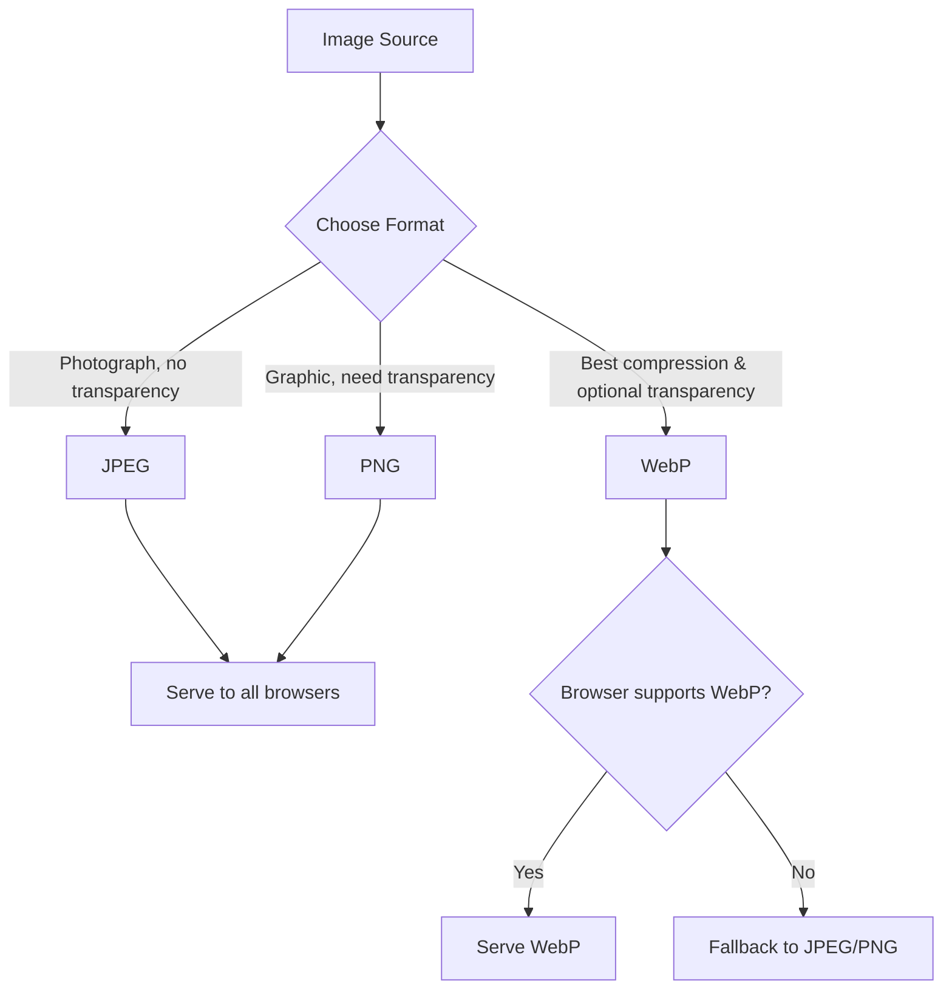

# 💡 JPEG vs JPG vs PNG vs WebP

> **TL;DR:** JPEG is lossy, PNG is lossless, and WebP combines both with optional transparency for superior web optimization.

---

## 👶 Explain Like I'm 5 (ELI5)

Imagine you have a box of crayons. JPEG is like a crayon that blends colors together, so you lose a little detail but you can draw a whole picture quickly and it fits in a small pocket. PNG is like a set of perfectly sharp, separate crayons; each color stays exactly as you put it, so the picture looks crisp but the box gets heavier. WebP is a magical crayon that can both blend smoothly when you want a photo and stay perfectly sharp when you need a clear edge, all while staying lighter than the other two. So when you share a drawing online, you pick the crayon that gives the best balance of size and detail for the job.

Think of sending a postcard: a JPEG postcard is thin and folds easily, a PNG postcard is thick and sturdy, and a WebP postcard is a clever hybrid that’s thin when it can be, but adds a protective coating when the picture needs it. The post office (your browser) accepts all of them, but the lighter the postcard, the faster it arrives.

---

## 🔍 The Technical Deep-Dive

At the byte level JPEG follows the ISO/IEC 10918‑2 standard. The encoder first converts RGB to Y'CbCr, subsamples chroma (usually 4:2:0), then applies an 8×8 DCT to each block, quantizes the coefficients using a quantization table, and finally entropy‑codes the result with Huffman or arithmetic coding. The lossy nature stems from quantization, which discards high‑frequency information.

PNG implements ISO/IEC 15948 (formerly PNG 1.2). The image is stored as lossless DEFLATE-compressed scanlines. It supports an 8‑bit or 16‑bit per channel palette, truecolor, and an optional alpha channel. No color space conversion occurs; each pixel value is preserved, and a CRC is attached to each chunk for integrity.

WebP, standardized by Google (RFC 7745), offers two modes. In lossy mode it uses a predictive coding scheme similar to intra‑frame video codecs: it predicts each pixel from neighboring pixels, encodes the residual with a DCT, then entropy‑codes with range coding. In lossless mode it applies a combination of pixel prediction, color transformation, and a custom entropy coder (LZ77‑based). Both modes support an 8‑bit alpha channel (lossless alpha always, lossy alpha optionally) and can embed ICC profiles, EXIF, and XMP metadata. The container is a RIFF‑based file, allowing multiple frames for animation.

From the OS perspective, all three formats are handled by libjpeg/libjpeg‑turbo, libpng, and libwebp respectively. When a web server serves an image, HTTP content‑negotiation (Accept header) can be used to serve WebP to browsers that advertise support, falling back to JPEG/PNG otherwise. Modern CDNs perform on‑the‑fly transcoding, leveraging these libraries to optimize size per request.

### 📊 Comparison Matrix

| Feature | JPEG | JPG | PNG | WebP |
|---|---|---|---|---|
| Compression | Lossy | Lossy | Lossless | Lossy & Lossless |
| Alpha Transparency | No | No | Yes | Yes (lossless) |
| Typical Size Reduction | 10‑20% smaller than PNG for photos | Same as JPEG | Larger than JPEG for photos | 25‑35% smaller than JPEG/PNG |
| Browser Support | ✅ all modern browsers | ✅ all modern browsers | ✅ all modern browsers | ✅ modern browsers (fallback needed for older) |
| Best For | Photographs, web thumbnails | Same as JPEG | Graphics, UI elements, icons | Mixed media, performance‑critical sites |

---

## 🗺️ Visual Architecture & Flow

---

## 🛠️ Real-World Production Scenarios

1. **E‑commerce product catalog** – High‑resolution product photos need fast load times. Use JPEG for the main gallery (lossy, small) and generate a WebP version for browsers that support it to shave another 20‑30% off bandwidth.
2. **SaaS dashboard icons** – UI elements require crisp edges and transparent backgrounds. PNG (or lossless WebP if you want smaller files) ensures sharpness and correct alpha handling across all browsers.
3. **News website with mixed content** – Articles contain both photographs and infographics. Implement a server‑side pipeline that stores originals as lossless PNG, then on‑the‑fly serves JPEG for photos, PNG for vector‑like graphics, and WebP when the Accept header includes `image/webp` to maximize overall page weight reduction.

---

## ⚠️ Common Myths & Gotchas

*Myth 1:* “JPG and JPEG are different formats.” – They are the same; the three‑letter extension is just a legacy DOS filename limitation.
*Myth 2:* “WebP is always better than PNG.” – WebP’s lossless mode can be larger than PNG for certain palette‑heavy images, and older browsers still require PNG fallbacks.
*Myth 3:* “Lossy compression always looks bad.” – Properly tuned JPEG or WebP settings can produce visually indistinguishable results while dramatically reducing size.

---

## 🔗 Authoritative References & RFCs

- [JPEG (ISO/IEC 10918‑2) Specification](https://www.w3.org/Graphics/JPEG/jfif3.pdf)
- [PNG (ISO/IEC 15948) Specification](https://www.w3.org/TR/PNG/)
- [WebP Container Specification (RFC 7745)](https://datatracker.ietf.org/doc/html/rfc7745)
- [MDN Web Docs – Image formats](https://developer.mozilla.org/en-US/docs/Web/Media/Formats/Image_types)
