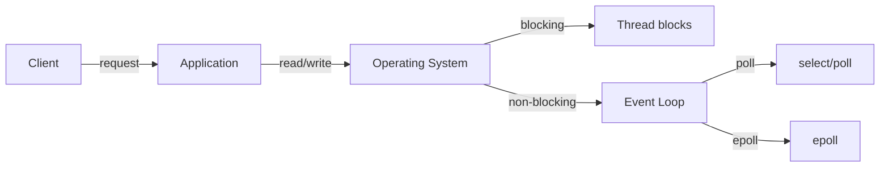

# 💡 I/O Models: Blocking vs Non-Blocking vs Epoll

> **TL;DR:** Blocking waits, non‑blocking polls, and epoll notifies – the difference is who does the waiting and how efficiently the kernel tells you when data is ready.

---

## 👶 Explain Like I'm 5 (ELI5)

Imagine a restaurant with a single waiter. In the *blocking* style, the waiter takes one order, walks to the kitchen, waits there until the dish is cooked, and only then returns to the next table. While he’s waiting, no other customers get served – the whole floor is idle.

Now picture the *non‑blocking* waiter who carries a notepad. He writes down every table’s order, drops the tickets in the kitchen, and immediately returns to the dining room. He keeps checking the kitchen window to see if any dish is done. If nothing is ready, he simply moves on to the next task instead of standing still.

Finally, think of a *smart bell* (epoll) installed in the kitchen. The waiter still drops tickets, but the kitchen rings a bell the moment any dish finishes. The waiter hears the bell and instantly knows which table to serve, without constantly peeking at the window. This lets the restaurant handle thousands of tables with just a few waiters.

---

## 🔍 The Technical Deep-Dive

At the kernel level, a *blocking* read/write call puts the calling thread into a sleep state (TASK_UNINTERRUPTIBLE or TASK_INTERRUPTIBLE) until the file descriptor becomes ready. The scheduler removes the thread from the run‑queue, freeing the CPU, but each concurrent connection still consumes a kernel stack, file‑descriptor table entry, and a context‑switch when it wakes up. This model scales poorly once you approach the classic C10K problem because the per‑thread overhead (memory, scheduler latency) dominates.

*Non‑blocking* I/O flips the contract: the file descriptor is opened with O_NONBLOCK, so read/write return immediately with EAGAIN if no data is available. The application must now drive an *event loop* that repeatedly asks the kernel whether any descriptor is ready. The traditional mechanisms are `select()` and `poll()`. Both require the kernel to iterate over the entire fd_set on each call, copying user‑space arrays into kernel space and performing O(N) readiness checks. For thousands of sockets, this linear scan becomes a bottleneck, and the system call overhead (copy‑in/out) adds latency.

`epoll` (Linux) introduces a level‑triggered and edge‑triggered API that decouples registration from notification. The application registers interest in a set of fds once via `epoll_ctl`. The kernel then maintains an internal red‑black tree (or hash) of these fds. When an event occurs, the kernel places a pointer to the fd into an *event ready list*. A subsequent `epoll_wait` simply drains this list, an O(1) operation regardless of the total number of registered descriptors. Edge‑triggered mode further reduces wake‑ups by notifying only on state transitions (e.g., from empty to non‑empty), requiring the application to drain the socket until EAGAIN. This model eliminates the O(N) per‑iteration cost, dramatically lowering CPU usage and enabling single‑threaded servers (Node.js, Nginx) to handle >100k concurrent connections with minimal memory footprint.

The OS also provides ancillary features: `EPOLLONESHOT` to avoid race conditions, `EPOLLRDHUP` for half‑close detection, and `EPOLLERR`/`EPOLLHUP` for error handling. Under the hood, the kernel uses interrupt vectors and poll‑wait queues to wake the waiting thread only when the ready list is non‑empty, preserving cache locality and reducing context‑switch churn.

### 📊 Comparison Matrix

| Feature | Blocking I/O | Non‑Blocking I/O (select/poll) | epoll (edge‑triggered) |
|---|---|---|---|
| Programming model | Simple, one‑thread per request | Event loop with readiness checks | Event loop with kernel‑driven notifications |
| Scalability (max fds) | ~1k (fd limit & thread memory) | ~10k (linear scan cost) | >100k (constant‑time ready list) |
| CPU usage (idle) | High (many threads sleeping) | Moderate (polling overhead) | Low (kernel wakes only when needed) |
| Memory overhead per connection | Thread stack (~1 MB) + fd | fd only, plus user‑space arrays | fd only, kernel internal structures |
| Complexity | Low | Medium (state management) | High (edge‑triggered semantics) |
| Best for | Simple scripts, low concurrency | Node.js‑style event loops, moderate traffic | High‑throughput servers (Nginx, HAProxy, custom C++ servers) |

---

## 🗺️ Visual Architecture & Flow

---

## 🛠️ Real-World Production Scenarios

1. **Chat server with 20k concurrent WebSocket connections** – Use epoll (edge‑triggered) in a single‑threaded C++ or Rust server. The kernel will notify only when a socket becomes readable or writable, keeping CPU usage low and avoiding per‑connection threads.
2. **Legacy CGI script handling occasional file uploads** – Blocking I/O is acceptable. Each request spawns a short‑lived process; the simplicity outweighs the overhead because traffic spikes are modest.
3. **Node.js microservice processing HTTP API calls at ~5k RPS** – Non‑blocking sockets with the built‑in libuv event loop (which uses epoll under the hood on Linux) provide a good balance: developers write async JavaScript while the runtime efficiently multiplexes many connections.

---

## ⚠️ Common Myths & Gotchas

*Myth 1:* “Non‑blocking automatically solves the C10K problem.” In reality, using `select()` or `poll()` still incurs O(N) scans, so you need epoll/kqueue or similar scalable APIs.
*Myth 2:* “epoll is always faster than threads.” For a tiny number of connections, the overhead of setting up epoll and edge‑triggered logic can outweigh the simplicity of a few blocking threads.
*Myth 3:* “Edge‑triggered means you never get another event.” You must drain the socket until EAGAIN; otherwise you may miss data because the kernel only signals on state changes.

---

## 🔗 Authoritative References & RFCs

- https://man7.org/linux/man-pages/man7/epoll.7.html
- https://www.kegel.com/dkftpbench/ (classic C10K benchmark discussion)
- https://nodejs.org/api/libuv.html (libuv’s use of epoll/kqueue)
- https://nginx.org/en/docs/ngx_core_module.html#worker_processes (Nginx event model)
