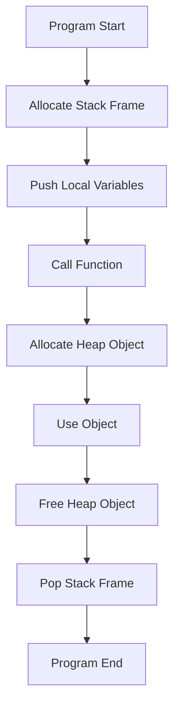

# 💡 Stack vs Heap Memory

> **TL;DR:** Stack memory is fast, ordered, and limited; heap memory is flexible, slower, and managed manually or by a garbage collector.

---

## 👶 Explain Like I'm 5 (ELI5)

Imagine a stack of plates in a cafeteria. When you need a plate, you take the top one, and when you’re done you put it back on top – it’s quick and you always know exactly where the next plate will be. This is like the call stack: each function call puts a “plate” (its local variables) on top, and when the function returns the plate is removed instantly.

Now picture a big toy box in the corner where you can toss any toy you want, pull it out later, and maybe even rearrange the toys inside. You have to remember where you put each toy, and sometimes you need to clean up the box so it doesn’t get a mess of empty spaces. That’s the heap: you request a chunk of memory, use it whenever you like, and later you must give it back, otherwise the box gets cluttered.

---

## 🔍 The Technical Deep-Dive

At the CPU level, the stack is a contiguous region of virtual memory whose pointer (the stack pointer register, e.g., RSP on x86_64) moves downwards (or upwards on some architectures) as frames are pushed. Each function call creates a stack frame containing return address, saved registers, and local variables. The OS reserves a guard page at the stack's end; a page fault on this guard triggers a SIGSEGV (stack overflow). Allocation is O(1) because it merely adjusts the stack pointer, and deallocation is equally cheap.

The heap lives in the process's data segment, managed by the runtime library (malloc/free, new/delete) or a garbage collector. When a request arrives, the allocator searches free lists or uses a binning strategy (e.g., dlmalloc, jemalloc) to find a suitably sized block, possibly splitting larger blocks. Freed blocks are coalesced to mitigate external fragmentation. Internally, the allocator requests memory from the OS via system calls like brk/sbrk or mmap, which map new pages into the process's address space. This extra indirection makes heap allocation slower (typically O(log n) or O(1) amortized) and introduces fragmentation, both internal (unused padding) and external (gaps between blocks). In managed languages, the GC periodically scans reachable objects, compacts live data (moving objects to eliminate fragmentation), and reclaims unreachable memory, adding pause times but simplifying programmer responsibility.

From the OS perspective, both stack and heap reside in virtual memory backed by physical pages. The kernel tracks page tables, enforces protection bits (read/write/execute), and can swap out rarely used heap pages, whereas the stack is usually kept resident for performance. Memory fragmentation can cause the OS to allocate non‑contiguous physical pages, but modern paging hides this from the process. Allocation speed, pointer dereferencing cost, and cache locality are all influenced by whether data lives on the stack (typically cache‑friendly) or the heap (potentially scattered).

### 📊 Comparison Matrix

| Feature | Stack | Heap |
|---|---|---|
| Allocation Speed | O(1) – just move stack pointer | Variable – allocator overhead, often O(log n) amortized |
| Access Time | Direct via offsets, excellent cache locality | Pointer dereference, may suffer cache misses |
| Lifetime | Scoped to function call; auto‑cleared | Manual (free/delete) or GC‑controlled; can outlive scope |
| Size Limits | Fixed size per thread (often a few MB) | Limited by virtual address space and OS limits |
| Fragmentation | None (contiguous) | External & internal fragmentation possible |
| Management | Implicit, handled by compiler/runtime | Explicit (malloc/free) or automatic (GC) |
| Typical Use Cases | Small, short‑lived data, recursion, call frames | Large, variable‑size structures, long‑lived objects |

---

## 🗺️ Visual Architecture & Flow

---

## 🛠️ Real-World Production Scenarios

1. **Recursive depth‑first search** – Each recursive call needs its own set of local variables and return address. Using the stack ensures O(1) allocation per call and automatic cleanup when the recursion unwinds.
2. **In‑memory cache of user sessions** – Sessions vary in size and live for minutes to hours. Allocating them on the heap lets the server grow or shrink the cache without risking stack overflow, and the GC can reclaim idle sessions.
3. **Embedded real‑time control loop** – Deterministic timing is critical; all buffers are pre‑allocated on the stack with fixed sizes to guarantee constant‑time allocation and avoid fragmentation that could jeopardize real‑time guarantees.

---

## ⚠️ Common Myths & Gotchas

1. *"Stack overflow only happens with infinite recursion"* – It can also occur from allocating huge local arrays or deep call chains in non‑recursive code.
2. *"Heap allocation is always slower than stack"* – Modern allocators (e.g., tcmalloc) can achieve near‑stack speeds for small objects, though worst‑case latency is higher.
3. *"Memory leaks only arise from forgetting to free heap memory"* – Leaks can also happen with reference cycles in GC‑managed languages, where objects remain reachable but never used.

---

## 🔗 Authoritative References & RFCs

- https://en.wikipedia.org/wiki/Call_stack
- https://man7.org/linux/man-pages/man3/malloc.3.html
- https://www.cs.cmu.edu/~fp/courses/15-440-F12/lectures/15-malloc.pdf
- https://www.kernel.org/doc/html/latest/vm/overcommit-accounting.html
