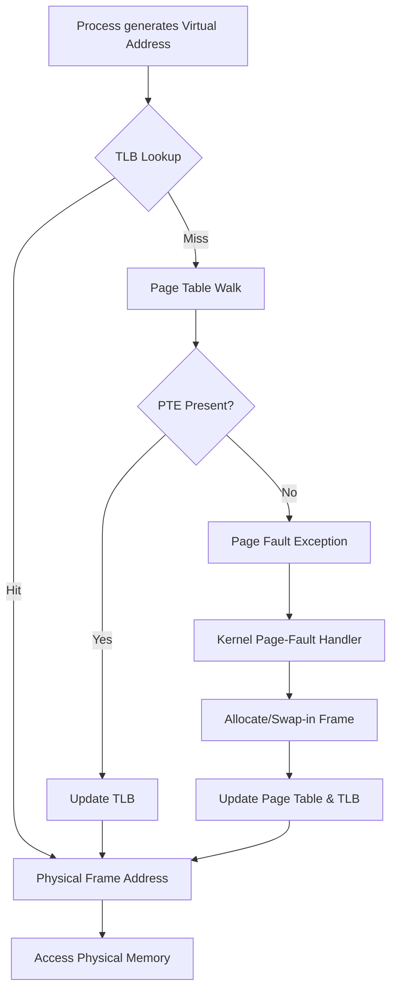

# 💡 Virtual Memory & Paging: How OS fakes infinite RAM

> **TL;DR:** Virtual memory tricks the CPU into thinking RAM is endless by swapping pages between RAM and disk using page tables and a TLB.

---

## 👶 Explain Like I'm 5 (ELI5)

Imagine your desk is a tiny tabletop, but you have a huge pile of books in a closet. Whenever you need a page from a book, you pull that page onto the desk, work with it, and then slide it back into the closet when you’re done. The desk never holds all the pages at once, yet you can read any part of any book as if the whole library were on the surface.

Now picture a super‑smart librarian (the OS) who knows exactly which page you’ll need next. She keeps a tiny cheat‑sheet (the TLB) of the most recent pages on the desk, so you don’t waste time looking them up. If the page isn’t there, she quickly fetches it from the closet (the disk) and swaps out something less important. Even though the desk is limited, you feel like you have the whole library at your fingertips.

---

## 🔍 The Technical Deep-Dive

The OS creates a virtual address space (VAS) for each process, partitioned into fixed‑size pages (commonly 4 KiB). Each page has a corresponding entry in a page table that maps the virtual page number (VPN) to a physical frame number (PFN) and stores permission bits, present/absent flags, and other metadata. When the CPU issues a memory access, the virtual address is split: the high‑order bits index the page table (or a multi‑level hierarchy) to locate the PTE, while the low‑order bits become the offset within the frame.

To avoid walking the page table on every access, modern CPUs implement a Translation Lookaside Buffer (TLB), a fully associative cache of recent VPN→PFN translations. On a TLB hit, the translation is immediate; on a miss, the hardware walks the page tables (often using a hardware page‑walk engine) and then populates the TLB. If the PTE’s present bit is clear, a page fault exception is raised. The kernel’s page‑fault handler determines whether the fault is due to a missing page (demand paging), a protection violation, or a copy‑on‑write event. For a missing page, the handler allocates a free frame (or evicts one via a replacement algorithm like LRU or CLOCK), reads the required data from the backing store (swap or file), updates the PTE, and resumes the faulting instruction.

When physical memory pressure grows, the system may start swapping out rarely used pages to disk, a process known as paging or swapping. Excessive paging leads to thrashing: the CPU spends more time handling page faults than executing useful work, dramatically degrading performance. Memory isolation is enforced by ensuring each process’s page tables only map its own VAS, and by setting appropriate permission bits (read/write/execute, user/supervisor). Modern extensions such as Extended Page Tables (EPT) for virtualization and Kernel Page‑Table Isolation (KPTI) further separate kernel and user mappings to mitigate side‑channel attacks.

### 📊 Comparison Matrix

| Feature                | Simple Single‑Level Paging | Hierarchical (2‑Level/4‑Level) Paging | Inverted Page Table | TLB Integration |
|------------------------|----------------------------|--------------------------------------|---------------------|-----------------|
| Address Space Size     | Limited by RAM size       | Supports 64‑bit address spaces       | Independent of VAS size | Cached translations |
| Lookup Cost            | O(1) but large memory      | O(n) page‑walks (n=levels)           | O(1) hash lookup    | O(1) on hit, miss triggers walk |
| Memory Overhead        | High (full table per process) | Moderate (sparse tables)            | Low (single global table) | Small hardware cache |
| Best For               | Embedded, low‑memory systems | General‑purpose OS, 64‑bit servers   | Hypervisors, large VMs | All modern CPUs |

---

## 🗺️ Visual Architecture & Flow

---

## 🛠️ Real-World Production Scenarios

1. **High‑Performance Database Server** – Uses large page sizes (2 MiB hugepages) and NUMA‑aware page allocation to reduce TLB misses and page‑walk latency, keeping latency low for transaction processing.
2. **Desktop Workstation Running Multiple VMs** – Relies on nested paging (EPT/VT‑x) where each VM has its own guest page tables, and the hypervisor maintains a second level of translation, allowing isolation while keeping overhead manageable.
3. **Embedded IoT Device with 256 KiB RAM** – Implements a single‑level page table with a tiny TLB and aggressive swapping to external flash, enabling the device to run a full POSIX‑like OS despite severe memory constraints.

---

## ⚠️ Common Myths & Gotchas

1. *"Virtual memory equals swap space"* – Virtual memory is the abstraction of mapping virtual addresses to physical frames; swapping is just one mechanism (disk backing) used when RAM is insufficient.
2. *"TLB eliminates page tables"* – The TLB only caches recent translations; the page tables still exist and are consulted on every miss.
3. *"More RAM always fixes thrashing"* – While additional RAM reduces pressure, thrashing can also stem from poor locality or mis‑tuned replacement policies; algorithmic changes are often required.

---

## 🔗 Authoritative References & RFCs

- https://www.kernel.org/doc/html/latest/vm/paging.html
- https://www.intel.com/content/www/us/en/architecture-and-technology/64-ia-32-architectures-software-developer-manual-325462.html#PAGEWALK
- https://en.wikipedia.org/wiki/Translation_lookaside_buffer
- https://www.usenix.org/legacy/event/hotos09/tech/full_papers/zhang.pdf
