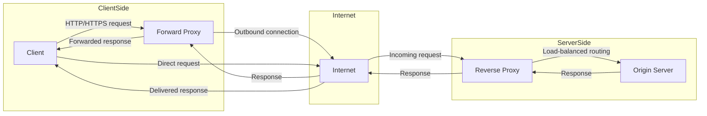

# 💡 Forward Proxy vs Reverse Proxy

> **TL;DR:** A forward proxy hides the client, a reverse proxy hides the server, each operating on opposite sides of the request flow.

---

## 👶 Explain Like I'm 5 (ELI5)

Imagine you want to send a birthday card but you don’t want the recipient to know it’s from you. You hand the card to a trusted neighbor who puts it in the mail for you. The neighbor knows who you are, but the person receiving the card only sees the neighbor’s return address. That neighbor is a forward proxy – it stands in front of you, forwards your request, and shields your identity.

Now picture a huge office building where every visitor first checks in at a reception desk. The receptionist asks where the visitor wants to go, then escorts them to the right office. The offices never see the visitor’s face; they only interact with the receptionist. That receptionist is a reverse proxy – it sits in front of the servers, receives all incoming traffic, decides which backend to talk to, and keeps the servers hidden from the outside world.

Both helpers can also keep copies of frequently asked letters. If the same birthday card is sent many times, the neighbor or receptionist can hand out a pre‑written copy instantly, saving time for everyone. This is the caching magic that both forward and reverse proxies can provide.

---

## 🔍 The Technical Deep-Dive

At the OS level a proxy is just another process that opens sockets on behalf of another endpoint. A forward proxy typically listens on a local address (e.g., 0.0.0.0:3128 for Squid) and accepts client connections. When a client issues an HTTP CONNECT (for HTTPS) or a full URL request, the proxy parses the request line, resolves the target hostname via DNS, and creates an outbound socket to the destination server. The proxy then shuttles bytes between the two sockets, optionally applying NAT rules, ACL checks, and logging. For caching, the proxy stores the raw HTTP response (headers + body) in a disk‑based object store keyed by the request URI and Vary headers; subsequent identical requests are served from this store, bypassing the outbound socket.

A reverse proxy, such as Nginx, binds to a public address (e.g., 0.0.0.0:80/443) and terminates client connections. For TLS it performs the handshake, decrypts the stream, and may re‑encrypt when forwarding to back‑ends (SSL‑passthrough or SSL‑offload). The proxy parses the HTTP request, evaluates routing rules (host, path, headers), and selects a backend pool. Load balancing algorithms (round‑robin, least‑conn, IP‑hash) dictate which backend socket is opened. The proxy may also cache responses based on Cache‑Control and Expires headers, storing them in shared memory zones for fast lookup. Internally Nginx uses an event‑driven, non‑blocking I/O model (epoll/kqueue) to multiplex thousands of connections with minimal threads, while Squid relies on a thread‑per‑connection or worker‑process model depending on configuration.

Both proxies manipulate the HTTP protocol at the byte level: they rewrite headers (e.g., X-Forwarded-For, Via), adjust Content‑Length after compression, and may inject or strip cookies. They also interact with the kernel’s networking stack for connection pooling, TCP fast open, and keep‑alive reuse, which reduces latency and CPU overhead. Advanced features like HTTP/2 multiplexing, gRPC proxying, or WebSocket tunneling require protocol‑aware handling of frames and binary payloads, but the core principle remains the same – a proxy is a transparent conduit that can observe, modify, and route traffic while presenting a different network face to the other side.

### 📊 Comparison Matrix

| Feature | Forward Proxy | Reverse Proxy |
|---|---|---|
| Primary Goal | Hide client identity & enforce outbound policies | Hide server topology & distribute inbound load |
| Typical Placement | Inside client LAN or ISP edge | In front of web/application servers (DMZ) |
| Common Software | Squid, Apache mod_proxy, TinyProxy | Nginx, HAProxy, Envoy, Traefik |
| Handles Outbound Traffic | Yes (client → proxy → internet) | No (receives inbound only) |
| Handles Inbound Traffic | No (does not accept external requests) | Yes (internet → proxy → server) |
| Caching | Often used for web caching to save bandwidth | Used for edge caching, CDN‑style acceleration |
| Load Balancing | Rare, usually just routing | Core feature – round‑robin, least‑conn, etc. |
| TLS Termination | Optional, usually passes through CONNECT | Common (SSL offload) |
| Authentication | Client auth (basic, NTLM, Kerberos) | Optional client auth for API gateways |
| Use Cases | Corporate internet filtering, anonymity, NAT traversal | API gateways, microservice routing, DDoS mitigation |
| Performance Overhead | Extra hop for every request, possible latency | Can reduce latency via caching & keep‑alive pooling |
| Configuration Complexity | ACL‑heavy, per‑site rules | Routing rules, upstream definitions |

---

## 🗺️ Visual Architecture & Flow

---

## 🛠️ Real-World Production Scenarios

1. **Corporate outbound filtering** – A large enterprise deploys Squid as a forward proxy on the edge of its LAN. All employee browsers are forced to use the proxy, allowing the IT team to enforce URL whitelists, scan for malware, and log every external request while keeping the internal IP range hidden from the public internet.
2. **Public API gateway** – An e‑commerce platform runs Nginx as a reverse proxy in front of a fleet of microservices. Nginx terminates TLS, validates JWT tokens, routes requests based on URL prefixes (/orders, /catalog), and balances load across multiple service instances. Cached GET responses for product data reduce latency and backend load.
3. **Edge CDN for static assets** – A media streaming service places Nginx reverse proxies at edge locations worldwide. The proxies cache video chunks and image files close to users, serve them directly, and forward only cache‑miss requests to the origin storage cluster. This setup shields the origin servers from massive traffic spikes and improves user experience.

---

## ⚠️ Common Myths & Gotchas

1. *Forward proxies are only for anonymity.* In reality they are also used for content filtering, bandwidth savings, and protocol translation inside corporate networks.
2. *A reverse proxy is just a load balancer.* While load balancing is a key feature, reverse proxies also provide TLS termination, request rewriting, authentication, and caching—functions a pure L4 balancer may lack.
3. *Only Nginx can act as a reverse proxy.* Historically, early web gateways used Apache mod_proxy or dedicated appliances; today many tools (HAProxy, Envoy, Traefik, Caddy) serve the same role with different trade‑offs.

---

## 🔗 Authoritative References & RFCs

- https://www.rfc-editor.org/rfc/rfc7230 (HTTP/1.1 Message Syntax and Routing)
- https://nginx.org/en/docs/ (Official Nginx documentation)
- https://wiki.squid-cache.org/Features/ForwardProxy (Squid forward proxy guide)
- https://www.rfc-editor.org/rfc/rfc2817 (Upgrading to TLS Within HTTP/1.1)
