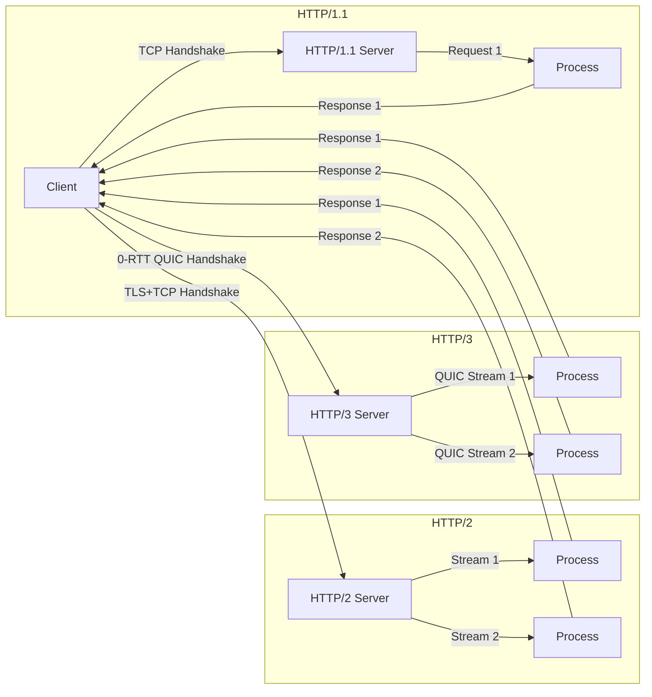

# 💡 HTTP/1.1 vs HTTP/2 vs HTTP/3

> **TL;DR:** HTTP/1.1 uses one TCP connection per request, HTTP/2 multiplexes many streams over a single TCP, and HTTP/3 does the same over QUIC/UDP, slashing latency and head‑of‑line blocking.

---

## 👶 Explain Like I'm 5 (ELI5)

Imagine sending letters by snail mail. With HTTP/1.1 you hand the post office one envelope, wait for it to travel to the destination, get a reply, then send the next envelope. If the road is blocked, every letter behind it is stuck too.

Now picture a multi‑lane highway where many cars (letters) travel side‑by‑side on the same road. That’s HTTP/2: many requests share one connection, so a jam in one lane doesn’t stop the others.

Finally, think of a fleet of drones that can fly directly to the receiver without waiting for road traffic. They can also talk to each other to avoid collisions and resend only the lost pieces. That’s HTTP/3 on QUIC/UDP – fast, resilient, and able to keep all deliveries moving even if one path hiccups.

---

## 🔍 The Technical Deep-Dive

HTTP/1.1 operates on a text‑based request/response model over TCP. Each request opens a TCP socket (or reuses one via keep‑alive) and the server processes it sequentially. Pipelining attempted to send multiple requests without waiting for responses, but because TCP delivers a byte stream in order, a lost packet stalls the entire stream – the classic head‑of‑line (HOL) blocking problem. TCP’s congestion control, retransmission, and three‑way handshake add latency, especially on high‑RTT links.

HTTP/2, defined in RFC 7540, switches to a binary framing layer. A single TCP connection is split into many logical streams, each identified by a 31‑bit stream ID. Frames (HEADERS, DATA, SETTINGS, etc.) are interleaved, allowing independent flow control per stream. Header compression (HPACK) reduces overhead, and server push lets the server pre‑emptively send resources. Because all streams share the same TCP flow, loss still blocks the whole connection at the transport level, but application‑level multiplexing prevents application‑level HOL blocking. TLS is negotiated once per connection, reducing handshake cost.

HTTP/3 (RFC 9114) moves the transport to QUIC, a UDP‑based protocol that implements TLS 1.3, stream multiplexing, and loss recovery in user space. QUIC assigns each connection a Connection ID, enabling seamless migration across IP changes (e.g., Wi‑Fi to cellular). Streams are independent; loss of a packet only affects the streams that carried the lost data, eliminating transport‑level HOL blocking. QUIC also supports 0‑RTT handshakes for repeat connections, further cutting latency. From the OS perspective, applications use a SOCK_DGRAM socket with QUIC libraries handling retransmission, congestion control, and TLS. The HTTP/3 layer reuses the same binary frame format as HTTP/2, so the semantics of streams, headers, and server push remain unchanged, but the underlying transport provides lower latency and better resilience on lossy networks.

### 📊 Comparison Matrix

| Feature | HTTP/1.1 | HTTP/2 | HTTP/3 |
|---|---|---|---|
| Transport | TCP | TCP | QUIC (UDP) |
| Multiplexing | No (one request per connection) | Yes (multiple streams per connection) | Yes (multiple streams per connection) |
| Head‑of‑line Blocking | TCP‑level and application‑level | TCP‑level only | None at transport level |
| Header Compression | None (plain text) | HPACK (binary) | HPACK (binary) |
| Server Push | No | Yes | Yes |
| Connection Setup Latency | 1‑RTT (TCP handshake) + TLS | 1‑RTT (TCP+TLS) | 0‑RTT possible (QUIC+TLS) |
| Ideal Use‑Case | Simple, low‑concurrency services | Asset‑heavy web pages | Mobile, high‑latency, lossy networks |
| Overhead | High per‑request TCP handshake | Low after initial handshake | Slightly higher per‑packet due to UDP + QUIC headers |

---

## 🗺️ Visual Architecture & Flow

---

## 🛠️ Real-World Production Scenarios

1. **High‑traffic news site with many static assets** – Use HTTP/2 to serve CSS, JS, and images over a single TCP connection, leveraging header compression and server push to reduce round‑trips.
2. **Live video streaming to mobile users on cellular networks** – Adopt HTTP/3 so that packet loss or network switches (Wi‑Fi ↔ LTE) don’t stall the stream; QUIC’s independent streams keep video frames flowing.
3. **Microservice mesh inside a data center** – HTTP/1.1 may suffice for simple request/response RPCs with low latency, but if services need to batch many calls over the same connection, HTTP/2 reduces handshake overhead; for cross‑region calls where latency dominates, HTTP/3 can shave milliseconds off each request.

---

## ⚠️ Common Myths & Gotchas

*Myth 1*: "HTTP/2 is always faster than HTTP/1.1." In reality, performance gains depend on the ability to multiplex and on TLS session reuse; on very low‑latency LANs the difference can be negligible.
*Myth 2*: "QUIC is just HTTP/2 over UDP." QUIC implements its own congestion control, stream multiplexing, and TLS 1.3 handshake, fundamentally changing transport behavior beyond a simple UDP wrapper.
*Myth 3*: "HTTP/3 eliminates all latency." While it removes transport‑level HOL blocking and enables 0‑RTT, DNS resolution, TLS session establishment, and application processing still contribute to overall latency.

---

## 🔗 Authoritative References & RFCs

- RFC 7230 – Hypertext Transfer Protocol (HTTP/1.1): Message Syntax and Routing
- RFC 7540 – Hypertext Transfer Protocol Version 2 (HTTP/2)
- RFC 9000 – QUIC: A UDP-Based Multiplexed Transport
- RFC 9114 – HTTP/3
