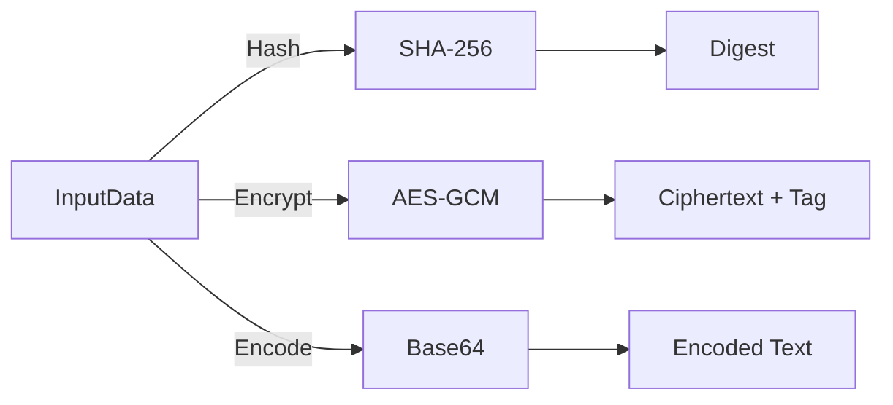

# 💡 Hashing vs Encryption vs Encoding

> **TL;DR:** Hashing is one‑way, encryption is two‑way with a secret key, and encoding is just a reversible format conversion.

---

## 👶 Explain Like I'm 5 (ELI5)

Think of three different ways to hide a secret note. First, you crush the paper into a unique pulp that can never be un‑crushed – that’s hashing. Second, you lock the note in a safe that only someone with the right key can open – that’s encryption. Third, you translate the note into a different alphabet that anyone can read if they know the alphabet – that’s encoding. 

When you hash a password with SHA‑256, you get a fingerprint that looks nothing like the original, and even if you see the fingerprint you can’t rebuild the password. Encryption with AES‑GCM wraps the data in a lock and also adds a tiny tag that proves the lock wasn’t tampered with. Encoding with Base64 simply changes binary bytes into printable characters so they can travel through email or URLs without getting corrupted.

---

## 🔍 The Technical Deep-Dive

At the OS level each operation starts as a byte buffer passed to a cryptographic library (e.g., OpenSSL, BoringSSL, libsodium). 

**Hashing (SHA‑256)**: The library pads the input according to the Merkle‑Damgård construction, processes 512‑bit blocks through 64 rounds of logical functions, and finally produces a 256‑bit digest. No key material is involved, but a *salt* can be concatenated or mixed into the initial state to thwart pre‑computed rainbow tables. The digest is written back to user space as a fixed‑size array; the CPU executes only integer‑rotate and XOR operations, making it cache‑friendly and constant‑time when implemented correctly. 

**Encryption (AES‑GCM)**: The caller supplies a 128‑/192‑/256‑bit secret key and a unique 96‑bit IV/nonce. The AES block cipher runs in Counter (CTR) mode to generate a keystream; each plaintext block is XOR‑ed with the keystream to produce ciphertext. Simultaneously, Galois Field multiplication accumulates an authentication tag (the “GCM” part) that guarantees integrity. The final output is *IV || ciphertext || tag*. On modern CPUs AES‑NI instructions accelerate the block encryptions, while the GCM multiplication uses carry‑less multiply (PCLMULQDQ). 

**Encoding (Base64)**: No cryptographic primitive is used. The binary stream is split into 6‑bit groups; each group indexes a character from the A‑Z, a‑z, 0‑9, ‘+’, ‘/’ alphabet (or URL‑safe variant). Padding ‘=’ characters are added to make the output length a multiple of four. This transformation is purely arithmetic (shift and mask) and can be done in‑place or via SIMD registers for massive throughput. Because the mapping is bijective, decoding simply reverses the process.

All three paths can be chained: a password may be *salted → hashed → Base64‑encoded* for storage, while a file may be *AES‑GCM encrypted → Base64 encoded* for transport over a JSON API. The OS kernel does not treat them specially; they are user‑space library calls that eventually invoke hardware acceleration or fall back to software routines.

### 📊 Comparison Matrix

**Feature**|**Hashing**|**Encryption**|**Encoding**
---|---|---|---
Purpose|Verify integrity, create fingerprint|Provide confidentiality and authenticity|Make binary safe for transport or display
Reversibility|One‑way (cannot recover original)|Two‑way with correct key|Fully reversible
Typical Algorithms|SHA‑256, bcrypt, Argon2|AES‑GCM, ChaCha20‑Poly1305|Base64, URL‑encode
Output Size|Fixed (e.g., 256 bits)|≈ input size + tag (16 bytes) |≈ 33 % larger than input
Performance|Very fast, CPU‑bound|Fast, includes IV/tag handling|Extremely fast, SIMD friendly
Need for Key|No|Yes (secret key)|No
Need for Salt/IV|Optional salt for hash|IV/nonce required|No
Security Guarantees|Collision resistance, pre‑image resistance|Confidentiality, integrity, authenticity|None (just representation)

---

## 🗺️ Visual Architecture & Flow

---

## 🛠️ Real-World Production Scenarios

1. **Password storage** – User passwords are salted, hashed with SHA‑256 (or a memory‑hard function like Argon2), and the resulting digest is Base64‑encoded before being written to the database. The hash can be verified but never reversed.
2. **Secure API payloads** – Sensitive JSON fields are encrypted with AES‑GCM using a per‑request nonce, then the binary ciphertext is Base64‑encoded so the entire payload remains valid UTF‑8 for HTTP transmission.
3. **Embedding binary assets** – A web service needs to embed a small PNG inside a JWT claim. The image bytes are Base64‑encoded (no security intent) and placed in the token; the token is then signed (not encrypted) to ensure integrity.

---

## ⚠️ Common Myths & Gotchas

1. *“Hashing is encryption, just slower.”* – Hashing discards information; even with infinite time you cannot retrieve the original input.
2. *“If I Base64‑encode data it’s safe from attackers.”* – Encoding only changes representation; anyone can decode it back to the original bytes.
3. *“Adding a salt makes a hash unbreakable.”* – Salt prevents pre‑computed attacks but does not protect against brute‑force if the underlying hash is weak or the password space is small.

---

## 🔗 Authoritative References & RFCs

- RFC 6234 – Secure Hash Standard (SHA‑2) 
- NIST SP 800‑38D – Recommendation for Block Cipher Modes of Operation: Galois/Counter Mode (GCM) 
- RFC 4648 – The Base64 Data Encodings 
- OpenSSL EVP documentation (https://www.openssl.org/docs/manmaster/man7/EVP_EncryptInit.html)
